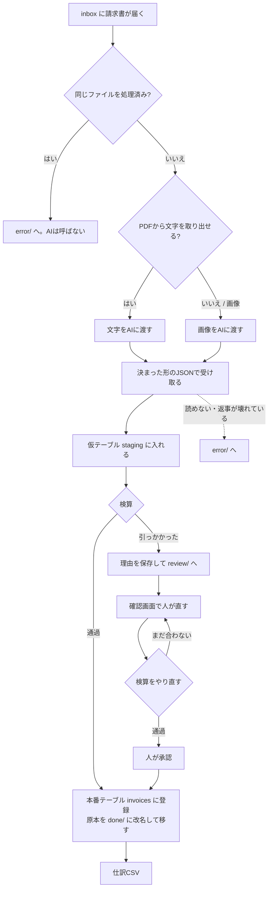

# 請求書読み取りツール

請求書（PDF・画像）をAIで読み取り、プログラムで検算して、通ったものだけを登録するツールです。
怪しいものは人が確認画面で原本を見ながら直し、承認します。承認済みの請求書から仕訳CSVを出力します。

AIに任せるのは「読むこと」だけで、計算が合っているかの判断はすべて普通のプログラムで行います。

## 何ができるか

- 画面で請求書のファイル（PDF / JPG / PNG）を選び、「読み取る」を押すと読み取る（何枚でもまとめて）
- 請求書番号、発行元、登録番号、日付、税率ごとの金額と消費税、源泉所得税、請求額、明細を取り出す
- 検算（明細の合計、消費税、請求額、源泉所得税、登録番号の検査数字、日付、二重登録、手書き）を行う
- 通ったものは登録し、原本を `YYYYMMDD_発行元_請求額.pdf` に改名して保管する
- 引っかかったものは理由付きで確認画面に出し、人が直して承認する。直した項目は履歴に残る
- 登録済みの請求書から仕訳CSV（借方：費用・仮払消費税、貸方：買掛金・預り金）を画面からダウンロードする

## 流れ



## 自動と人力の分け方

| 担当 | やること | なぜ |
|---|---|---|
| AI | 請求書から項目を読み取る | 様式がばらばら（罫線の表、和暦、「金〇〇円也」、内税、個人事業主の源泉所得税）で、決まった位置から読むプログラムでは対応しきれない |
| プログラム | 検算、二重登録の確認、ファイルの移動、DBへの登録 | 足し算や桁数は、AIより普通のプログラムのほうが確実で、なぜ止めたかを説明できる |
| 人 | 要確認の修正と承認 | 請求書そのものが間違っている場合（請求額のずれなど）は、発行元への問い合わせなど人の判断が要る |

AIの読み取り結果は、必ず仮テーブルに入れてから検算します。本番テーブルに直接入れることはありません。
読み間違いがあっても、金額や日付が合わなければ検算で止まるので、そのまま登録されることはありません。

## 精度

架空の請求書30枚（5様式×6枚、うちスキャン風の画像6枚、わざと誤りを入れたもの3枚）で測りました。
モデルは claude-opus-5-5（思考の深さ medium）。詳しくは [docs/精度.md](docs/精度.md)。

| | 文字（PDF 24枚） | 画像（30枚） |
|---|---|---|
| 7項目（請求額、登録番号、発行日、支払期日、請求書番号、発行元、税額）すべて一致 | 100%（24/24） | 100%（30/30） |
| 誤りを入れた請求書を止めた | 3 / 3 | 3 / 3 |
| 正しい請求書を誤って止めた | 0 / 21 | 0 / 27 |
| 1枚あたりの時間 | 3.8秒 | 4.5秒 |
| 1枚あたりの費用の目安 | 約0.020ドル | 約0.035ドル |

1回目の測定では「7項目すべて一致」が文字79%・画像73%でした。原因（名前の空白の全角・半角、「第〇〇号」の欠け、
自分の指示文が名前の一部を削らせていた）を調べて直した結果が上の表です。経緯は [docs/作業記録.md](docs/作業記録.md) にあります。

指示文を直すのに使った30枚と測った30枚が同じなので、この100%は新しい請求書での精度を保証するものではありません。

## 使い方

`請求書ツールを開く.bat` をダブルクリックすると、ブラウザで画面が開きます（初めてのときは下の「準備」が要ります）。
黒い画面は、使っている間は閉じないでください。デスクトップに置きたいときは、右クリックの「送る」→「デスクトップ（ショートカットを作成）」で置けます。

| ページ | やること |
|---|---|
| 読み取り | 請求書のファイルを置いて「読み取る」を押す。検算が通ったものは登録され、合わないものは「要確認」に回る |
| 要確認 | 左に原本、右に読み取った値。引っかかった項目には朱色の線と理由が出る。値を直して「直した値で検算する」を押し、通ったら「承認して登録する」を押す |
| 登録済み | 登録した請求書の一覧。発行月で絞り込み、「仕訳CSVをダウンロード」で会計ソフトに取り込む仕訳を保存する |

見た目は、請求書受領サービスの照合画面（原本と読み取り値を左右に並べる）を参考にしました。
書体は帳票向けの BIZ UDPゴシック、金額と登録番号は等幅の BIZ UDゴシックで桁をそろえています。

## 準備

使うPCで一度だけ行います。Python 3.11 以上が必要です。

```
python -m venv .venv
.venv\Scripts\activate          # macOS / Linux は source .venv/bin/activate
pip install -r requirements.txt
copy .env.example .env          # macOS / Linux は cp .env.example .env
```

`.env` に Anthropic の APIキーとモデル名を入れます。`.env` はGitに上げません。

```
ANTHROPIC_API_KEY=（自分のキー）
MODEL=claude-opus-5-5
```

画面が開かないときは、`data/app.log` に起動の記録が残っています。

## 開発者向けのコマンド

| やること | コマンド |
|---|---|
| テスト（APIは呼ばない） | `pytest` |
| 画面を直接起動 | `streamlit run app/main.py` |
| `data/inbox/` の請求書をまとめて処理 | `python scripts/run_batch.py` |
| 仕訳CSVを出力（`data/journal.csv`） | `python scripts/export_journal.py` |
| 30枚で精度を測る（APIを54回呼ぶ。約1.5ドル） | `python scripts/evaluate.py` |

試すときは、`sample_data/invoices/` の請求書を画面で読み取ります（`sample_data/` は書き換えません）。

## フォルダ

```
src/invoice_reader/
  config.py        設定（.env）と実行時フォルダ
  extract.py       PDFから文字を取り出す。取り出せなければ画像にする
  llm.py           AIに渡し、決まった形のJSONで受け取る
  validate.py      検算
  db.py            DBへの接続とSQL（SQLはここにだけ書く）
  pipeline.py      1件を届いてから登録・要確認まで流す
  review.py        確認画面の裏側（修正の保存と履歴、承認）
  export.py        仕訳CSV
  ground_truth.py  正解データの読み込み
app/
  main.py          画面の入口（ページの切り替え、見た目）
  views/           読み取り、要確認、登録済みの各ページ
  shared.py        ページで共通に使うもの
scripts/           open_app.py（画面を開く）、run_batch.py、evaluate.py、export_journal.py
請求書ツールを開く.bat  ダブルクリックで画面を開く
tests/             pytest（APIは呼ばない。AIの代わりに偽物を使う）
sample_data/       架空の請求書30枚と正解データ
docs/              作業書、作業記録、精度
data/              実行時のフォルダとDB（Gitに上げない）
```

## 技術

- Python、SQLite（STRICT テーブルで金額の列に整数以外を入れられないようにしている）
- Anthropic API（構造化出力でJSONの形を固定し、Pydantic の strict モードで型を確かめる）
- pdfplumber（PDFの文字）、PyMuPDF（PDFを画像に）
- Streamlit（画面）、pytest

## まだやっていないこと

- 社内の別のPCから開くこと。今はツールを入れたPCでだけ開ける（共有のサーバーに置くにはログインの仕組みが要る）
- 勘定科目の自動選択。今は源泉所得税があれば「支払報酬料」、なければ「仕入高」で決め打ち
- DB接続の Oracle 版（SQLは `db.py` にまとめてあるので、差し替えはそこだけで済む想定）
- 手書きの請求書での確認（実物はリポジトリに入れない方針のため、手元でのみ試す）

## 注意

請求書はすべて架空のデータです。記載の会社・人物・番号は実在しません。
